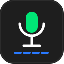

# OpenDictate — Локальная голосовая диктовка для Linux

<div align="center">



**Быстрая офлайн-печать голосом на русском и английском языках (Whisper GGML)**  
Нажал клавишу в любом приложении — сказал фразу — отпустил — текст скопирован и готов к вставке.

[Архитектура](docs/PLAN.md) •
[Установка](#установка-на-linux-alt-linux-и-др) •
[Использование](#использование) •
[Настройки](#параметры)

</div>

---

## Особенности

- **Полный офлайн и приватность**: Распознавание речи выполняется на 100% локально на CPU через оптимизированный движок `whisper.cpp` (квантование GGML). Никакие аудиоданные не отправляются в сеть.
- **Русский язык из коробки + автоопределение**: Дефолтная модель понимает русскую речь и IT-сленг; режим `auto` оставляет английские термины латиницей.
- **9 моделей Whisper на выбор**: от лёгкой `tiny` до `large-v3-turbo` — переключение из трея/GUI/CLI без рестарта.
- **Автовставка**: текст сам печатается через Ctrl+V (uinput), кириллица safe.
- **Поддержка глобальных клавиш в Wayland и X11**: Перехват нажатия клавиш на уровне ядра через Linux `evdev` (`/dev/input/event*`), работает в Niri, GNOME, Sway, Hyprland и KDE.
- **Звуковая обратная связь**: Короткие приятные системные звуковые сигналы (бипы) при начале и завершении записи — диктовать можно не глядя на экран.
- **Системный трей + GTK-настройки**: Работает в фоне со свернутым меню (StatusNotifierItem): язык, модель, автовставка. Полноценное окно настроек `opendictate-gui`.
- **Идеальная связка с OpenMic**: Захватывает звук прямо из системного PipeWire-микрофона по умолчанию (включая смартфон с OpenMic).

---

## Установка на Linux (ALT Linux и др.)

### 1. Системные зависимости
```bash
# ALT Linux (p10 / p11 / Sisyphus)
sudo apt-get update
sudo apt-get install rust rust-cargo pipewire-utils wl-clipboard libgtk4-devel libadwaita-devel
```
*Убедитесь, что ваш пользователь состоит в группе `input` (`sudo gpasswd -a $USER input`, затем перелогиньтесь).*
*Для автовставки Ctrl+V один раз выполните: `sudo install -m644 assets/90-opendictate.rules /etc/udev/rules.d/ && sudo udevadm trigger /dev/uinput` (install.sh подскажет сам).*

### 2. Сборка и установка
В корне репозитория запустите скрипт установки (не требует прав root):
```bash
git clone https://github.com/pgeyko/opendictate.git
cd opendictate
./install.sh
```

Скрипт автоматически:
- Скомпилирует оптимизированные релизные бинарники (`opendictate`, `opendictate-gui`).
- Установит их в `~/.local/bin/`.
- Разложит иконки всех стандартных разрешений (`48x48`, `64x64`, `128x128`, `svg`).
- Установит десктопные ярлыки (`opendictate.desktop`, `opendictate-gui.desktop`).

---

## Использование

1. Запустите **OpenDictate** из меню приложений или командой в терминале:
   ```bash
   opendictate
   ```
   *(При самом первом запуске программа автоматически скачает веса модели `ggml-base.bin` ~140 МБ и подготовит движок whisper)*.
2. В системном трее появится иконка микрофона.
3. В любом приложении (браузер, Telegram, редактор кода, терминал) зажмите клавишу **`Pause / Break`** (также поддерживаются **`F12`** или **`Scroll Lock`**):
   - Раздастся короткий высокий сигнал — говорите фразу.
4. Отпустите клавишу:
   - Раздастся сигнал окончания записи, нейросеть расшифрует голос.
   - Текст скопируется в буфер и (если включена автовставка) сам напечатается через Ctrl+V.

Настройки (`opendictate-gui` из меню): модель распознавания, язык (`ru/en/auto`),
свой контекст-подсказка, тумблер автовставки, живая последняя фраза.

---

## Параметры CLI

```bash
opendictate --help
  -l, --language <LANGUAGE>  Язык: ru | en | auto [default: ru]
  -m, --model <MODEL>        Пресет (tiny|base|small|turbo|...) или путь к .bin [default: base]
      --beam <BEAM>          Beam size декодера [default: 5]
      --prompt <PROMPT>      Свой initial prompt (пусто = встроенный IT-словарь)
      --auto-paste <true|false>  Автовставка Ctrl+V [default: true]
  -d, --debug                Подробные логи
```

Модели лежат в `~/.local/share/opendictate/models/`, докачиваются сами при выборе.

---

## Лицензия и авторство

- **Автор**: [Pavel Geiko](https://github.com/pgeyko) (<pawelgeyko@gmail.com>)
- **Разработка**: Проект спроектирован и реализован с использованием ИИ-агента OpenCode (модель Gemini 3.8 Flash).
- **Лицензия**: Распространяется под условиями лицензии **Apache 2.0** (см. [LICENSE](LICENSE)).
